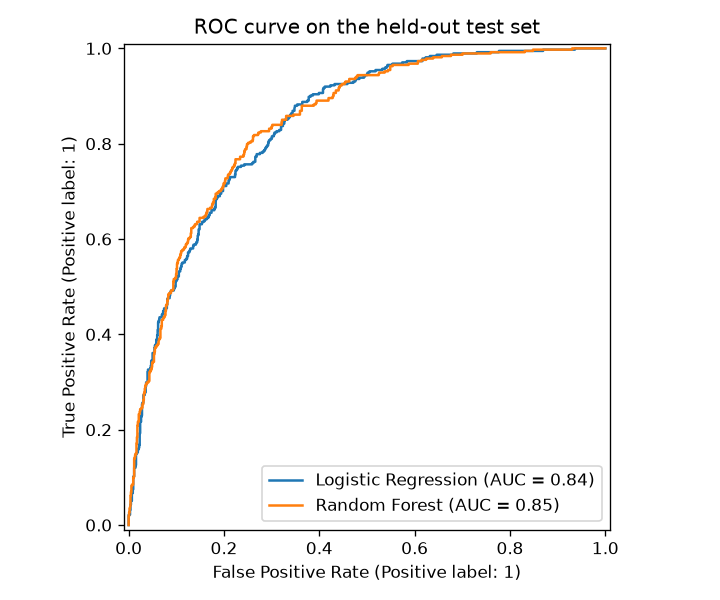
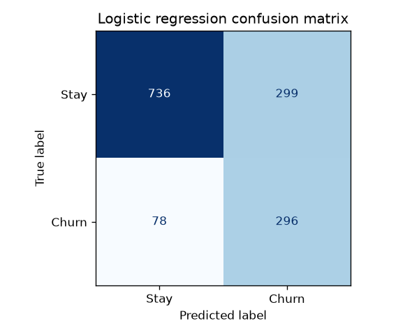
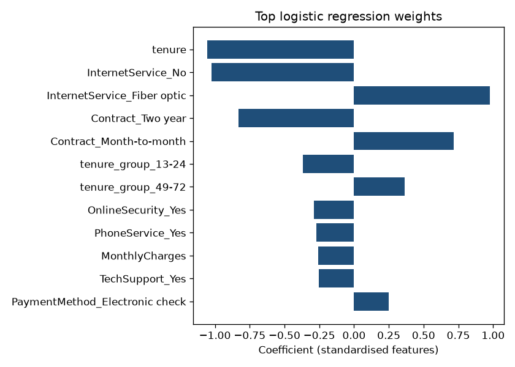

# Churn prediction report

Dataset: IBM Telco Customer Churn (7043 customers after cleaning).
Source: https://github.com/IBM/telco-customer-churn-on-icp4d
Licence: Apache License 2.0

Train/test split: 80/20, stratified, `random_state=42`.
Both models use `class_weight='balanced'`. The decision threshold is 0.5.

## Test-set metrics

| Model | ROC-AUC | Precision | Recall | F1 | Accuracy |
| --- | ---: | ---: | ---: | ---: | ---: |
| Logistic regression | 0.842 | 0.497 | 0.791 | 0.611 | 0.732 |
| Random forest | 0.845 | 0.529 | 0.805 | 0.638 | 0.758 |

## Confusion matrices (test set)

- Logistic regression: TN=736, FP=299, FN=78, TP=296
- Random forest: TN=767, FP=268, FN=73, TP=301

## Charts

